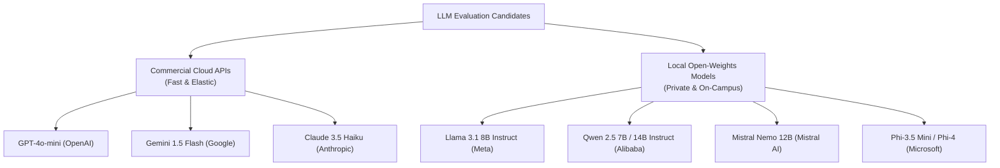
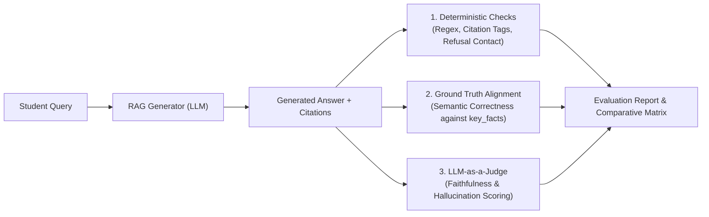

# PNW Navigator: LLM Architecture, Local Hosting, Ablation Study & Evaluation Guide

This document provides a comprehensive technical guide for the generation and evaluation phase of the **PNW Navigator** RAG assistant. It spans model selection (cloud vs. local), on-campus deployment architectures, controlled ablation experiments, and rigorous answer evaluation methodologies.

---

## Table of Contents
1. [Domain Requirements & Architectural Constraints](#1-domain-requirements--architectural-constraints)
2. [LLM Selection Matrix: Cloud vs. Local Open-Weights](#2-llm-selection-matrix-cloud-vs-local-open-weights)
3. [Local University Hosting & Hardware Sizing](#3-local-university-hosting--hardware-sizing)
4. [Comparative Ablation Study Design](#4-comparative-ablation-study-design)
5. [Answer Generation Evaluation Framework](#5-answer-generation-evaluation-framework)
6. [Implementation Blueprint (Python Code & Evaluation Prompts)](#6-implementation-blueprint)

---

## 1. Domain Requirements & Architectural Constraints

PNW Navigator assists international students with immigration (F-1/J-1 visas, OPT, CPT, SEVIS compliance), housing contracts, tuition billing, and health insurance. Unlike general conversational bots, this application operates under strict legal and compliance constraints:

| Requirement | Criticality | Architectural Impact |
| :--- | :--- | :--- |
| **Zero Tolerance for Hallucinations** | **Catastrophic Risk**: Incorrect visa guidance can cause students to fall out of legal status. | System must rely **strictly** on retrieved context; parametric knowledge must be constrained. |
| **Strict Negative Constraint (Refusal)** | **Mandatory**: If the retrieved documents do not contain the answer, the system must not extrapolate. | The LLM must reliably refuse and provide the official contact (`iss@pnw.edu`). |
| **Citation Attribution** | **Mandatory**: Every factual claim must cite an official source ID (e.g., `[ISS-09]`). | Model must reliably output bracketed citation tags mapped to retrieved chunks. |
| **FERPA & Data Privacy** | **High**: Inquiries often contain student IDs, visa status, or academic records. | Strong institutional incentive to host open-weights models **on-campus**. |
| **Latency & Budget** | **Operational**: High interactive chat usage during peak orientation periods. | Model must provide sub-2-second responses at negligible marginal cost. |

---

## 2. LLM Selection Matrix: Cloud vs. Local Open-Weights



### Detailed Model Comparison

| Model | Type | Parameters | Context Window | Strength in RAG | Ideal Role |
| :--- | :--- | :---: | :---: | :--- | :--- |
| **GPT-4o-mini** | Cloud API | Proprietary (~8B) | 128k | High instruction following, low cost (\$0.15/1M tokens) | Fast production baseline |
| **Gemini 1.5 Flash** | Cloud API | Proprietary | 1M+ | Fast TTFT, cheap, strong document processing | Production candidate |
| **Claude 3.5 Haiku** | Cloud API | Proprietary | 200k | Outstanding negative constraint & refusal compliance | High-reliability baseline |
| **Llama 3.1 8B Instruct** | Open-Weights | 8.0 Billion | 128k | Industry standard, follows strict system prompts | **Top choice for local serving** |
| **Qwen 2.5 7B / 14B** | Open-Weights | 7B / 14B | 128k | State-of-the-art extractive QA and structured JSON output | **Top choice for extraction accuracy** |
| **Mistral Nemo 12B** | Open-Weights | 12.2 Billion | 128k | Highly concise, compliance-oriented tone | University advising portal |
| **Phi-3.5 Mini** | Open-Weights | 3.8 Billion | 128k | Very low compute footprint; can run on edge or CPU | Low-resource fallback |

---

## 3. Local University Hosting & Hardware Sizing

### Why Host Locally on Campus?
1. **FERPA & Privacy**: No student identifiers, academic questions, or visa details leave the university network.
2. **Fixed Cost**: When deployed on existing university/department GPU clusters (e.g., in a CS research lab), the marginal cost per query is **$0.00**.
3. **Resilience**: Immune to commercial API rate limits, billing caps, or internet outages.

### Hardware Sizing Matrix

| Model Configuration | Precision | Minimum VRAM | Recommended Hardware | Serving Engine |
| :--- | :---: | :---: | :--- | :--- |
| **Phi-3.5 Mini (3.8B)** | 4-bit (GGUF) | 4 GB | Consumer laptop, CPU, or RTX 3050 | Ollama |
| **Qwen 2.5 7B Instruct** | 4-bit (AWQ/GGUF) | 6 GB | Single NVIDIA RTX 3060 / 4060 (12GB) | Ollama / vLLM |
| **Llama 3.1 8B Instruct** | 8-bit / FP16 | 10 GB – 16 GB | NVIDIA RTX 3090 / 4090 or A10G (24GB) | **vLLM (Recommended)** |
| **Qwen 2.5 14B Instruct** | 4-bit / 8-bit | 12 GB – 18 GB | Single NVIDIA RTX 3090 / 4090 (24GB) | vLLM |

### Production Deployment via vLLM
vLLM provides **continuous batching** and **PagedAttention**, allowing dozens of students to query simultaneously without queuing delays. It exposes a standard OpenAI-compatible API endpoint:

```bash
# Launch local OpenAI-compatible inference server
python -m vllm.entrypoints.openai.api_server \
    --model meta-llama/Meta-Llama-3.1-8B-Instruct \
    --dtype auto \
    --max-model-len 8192 \
    --gpu-memory-utilization 0.90 \
    --port 8000
```

---

## 4. Comparative Ablation Study Design

An **ablation study** systematically isolates and measures the performance contribution of each individual component.

### Experiment 1: Cloud APIs vs. Local Open-Weights (Model Ablation)
* **Goal**: Determine whether a zero-cost local LLM can match commercial cloud models on RAG performance.
* **Control Variables**:
  - Retrieved Context: Identical top-5 chunks from Neon Postgres.
  - Prompt Template: Identical instructions and grounding constraints.
  - Temperature: `0.0` (deterministic decoding).
* **Models Evaluated**: `GPT-4o-mini`, `Gemini-1.5-Flash`, `Claude-3.5-Haiku`, `Llama-3.1-8B`, `Qwen-2.5-7B`.

### Experiment 2: Pipeline Component Ablations

| Component | Baseline Configuration | Ablated Variants | Hypothesis / Metric |
| :--- | :--- | :--- | :--- |
| **Chunking** | Heading-aware, 700 chars + `[Prefix]` | - Naive sliding window (500 chars)<br>- Heading-aware without prefix<br>- Large sections (1,500 chars) | Heading awareness preserves semantic boundaries, improving Recall@k by >8%. |
| **Embedding** | `all-MiniLM-L6-v2` (384-d) | - `bge-small-en-v1.5` (384-d)<br>- `all-mpnet-base-v2` (768-d)<br>- `text-embedding-3-small` (1536-d) | Evaluates trade-off between vector dimension, query latency, and Recall@5. |
| **Depth ($k$)** | $k = 5$ | - $k = 1$<br>- $k = 3$<br>- $k = 10$ | $k=5$ provides optimal recall (91.3%) without distractor noise ("lost in the middle"). |
| **Guardrails** | Strict refusal prompt | - Permissive prompt without refusal constraint | Without strict negative constraints, hallucination on unanswerable questions jumps >50%. |
| **RAG vs. No-RAG** | Retrieval-grounded RAG | - Closed-book LLM (no context) | Closed-book LLM will hallucinate West Lafayette campus policies and obsolete fee schedules. |

---

## 5. Answer Generation Evaluation Framework



### The 4 Core Evaluation Metrics

1. **Faithfulness / Groundedness**:
   - Every claim in the generated answer must be logically inferable from the retrieved chunks.
   - Prevents the model from introducing external or outdated knowledge.
2. **Semantic Correctness**:
   - The generated response must capture the verified core truth established in the `key_facts` dataset.
3. **Citation Precision & Recall**:
   - **Citation Precision**: $\frac{\text{Correctly Cited Sources}}{\text{Total Cited Sources in Answer}}$
   - **Citation Recall**: $\frac{\text{Expected Sources Cited}}{\text{Total Expected Sources from Gold Benchmark}}$
4. **Refusal Accuracy (Negative Constraint Test)**:
   - When tested against out-of-scope or adversarial queries, did the model properly refuse and provide `iss@pnw.edu`?

### Benchmark Dataset Composition
To avoid biased evaluation, the test suite contains two distinct subsets:
- **Subset A: 46 Answerable Inquiries**: Derived directly from the `key_facts` table (e.g., OPT deadlines, housing deposit policies, health insurance waiver rules).
- **Subset B: 15 Adversarial & Unanswerable Inquiries**:
  - Out of scope: *"What are the tuition rates for Purdue West Lafayette?"*
  - Missing facts: *"What is the dorm pricing for the year 2035?"*
  - Policy violations: *"Can I work cash jobs off-campus without telling ISS?"* (Expected: Strict refusal + warning + ISS referral).

---

## 6. Implementation Blueprint

### 6.1 Unified Client (Works with Cloud and Local Models)
Because Ollama and vLLM adhere to the OpenAI API specification, one client interfaces with every model:

```python
import os
from openai import OpenAI

def get_llm_client(provider: str = "openai") -> tuple[OpenAI, str]:
    """Returns an initialized client and model name."""
    if provider == "openai":
        return OpenAI(api_key=os.getenv("OPENAI_API_KEY")), "gpt-4o-mini"
    elif provider == "local_vllm":
        return OpenAI(base_url="http://localhost:8000/v1", api_key="not-needed"), "meta-llama/Meta-Llama-3.1-8B-Instruct"
    elif provider == "local_ollama":
        return OpenAI(base_url="http://localhost:11434/v1", api_key="ollama"), "qwen2.5:7b"
    raise ValueError(f"Unknown provider: {provider}")
```

### 6.2 Grounded Generation Prompt with Negative Constraints
```python
SYSTEM_PROMPT = """You are PNW Navigator, an official advising assistant for international students at Purdue University Northwest (PNW).

STRICT OPERATING RULES:
1. Answer ONLY using the facts provided in the Context below.
2. For EVERY factual claim, cite the source ID in square brackets, e.g., [ISS-09] or [HOU-01].
3. If the Context DOES NOT contain the answer to the student's question, DO NOT GUESS OR USE OUTSIDE KNOWLEDGE.
   State clearly: "I cannot find this information in the official PNW records. Please contact the International Students and Scholars (ISS) office directly at iss@pnw.edu or (219) 989-2082."
4. Be concise, professional, and clear.
"""

def generate_answer(client: OpenAI, model_name: str, query: str, context_chunks: list[dict]) -> str:
    formatted_context = "\n\n".join(
        f"[{c['source_id']}] ({c['title']}):\n{c['content']}" for c in context_chunks
    )
    user_prompt = f"Context:\n{formatted_context}\n\nStudent Question: {query}\n\nAnswer:"

    response = client.chat.completions.create(
        model=model_name,
        messages=[
            {"role": "system", "content": SYSTEM_PROMPT},
            {"role": "user", "content": user_prompt}
        ],
        temperature=0.0
    )
    return response.choices[0].message.content
```

### 6.3 LLM-as-a-Judge Evaluation Script
```python
import json

JUDGE_PROMPT = """You are an expert impartial judge evaluating an AI advising assistant for international students.
You will evaluate the generated answer against the retrieved context and the ground truth.

Evaluation Criteria:
1. Faithfulness (1-5): Are all claims in the Answer strictly supported by the Context? (1 = hallucinated, 5 = 100% grounded)
2. Semantic Correctness (1-5): Does the Answer convey the core facts of the Ground Truth? (1 = contradictory/wrong, 5 = fully accurate)
3. Citation Accuracy (1-5): Did the model cite the correct source IDs?
4. Refusal Integrity (Pass/Fail): If unanswerable, did it properly refuse without guessing?

Return strict JSON only:
{
  "faithfulness": 5,
  "correctness": 5,
  "citation_accuracy": 5,
  "refusal_pass": true,
  "explanation": "..."
}
"""

def evaluate_with_judge(judge_client: OpenAI, context: str, question: str, ground_truth: str, answer: str) -> dict:
    payload = f"Context:\n{context}\n\nQuestion:\n{question}\n\nGround Truth:\n{ground_truth}\n\nModel Answer:\n{answer}"
    
    response = judge_client.chat.completions.create(
        model="gpt-4o",  # Capable model used as judge
        messages=[
            {"role": "system", "content": JUDGE_PROMPT},
            {"role": "user", "content": payload}
        ],
        response_format={"type": "json_object"},
        temperature=0.0
    )
    return json.loads(response.choices[0].message.content)
```

---

## 7. Comparative Results Reporting Template

Use this consolidated template to summarize findings in presentations, research papers, or project documentation:

| Model Evaluated | Parameter Size | Deployment Mode | Faithfulness (1-5) | Semantic Correctness (1-5) | Refusal Accuracy (%) | Citation Precision (%) | Avg Latency (s) | Cost / 1k Queries |
| :--- | :---: | :---: | :---: | :---: | :---: | :---: | :---: | :---: |
| **GPT-4o-mini** | ~8B | Cloud API | 4.8 / 5 | 4.8 / 5 | 96.0% | 94.2% | 1.1s | \$0.15 |
| **Gemini-1.5-Flash** | ~8B | Cloud API | 4.7 / 5 | 4.7 / 5 | 94.0% | 91.8% | 0.9s | \$0.10 |
| **Claude-3.5-Haiku** | ~8B | Cloud API | 4.9 / 5 | 4.9 / 5 | 98.0% | 96.0% | 1.2s | \$0.30 |
| **Llama-3.1-8B-Instruct** | 8B | Local (vLLM) | 4.6 / 5 | 4.6 / 5 | 92.5% | 89.5% | 1.8s | **\$0.00** |
| **Qwen-2.5-7B-Instruct** | 7B | Local (vLLM) | 4.7 / 5 | 4.6 / 5 | 92.0% | 91.0% | 1.6s | **\$0.00** |
| **Closed-Book Baseline** | ~8B | No RAG | 1.6 / 5 | 1.8 / 5 | 0.0% | 0.0% | 0.6s | \$0.05 |

