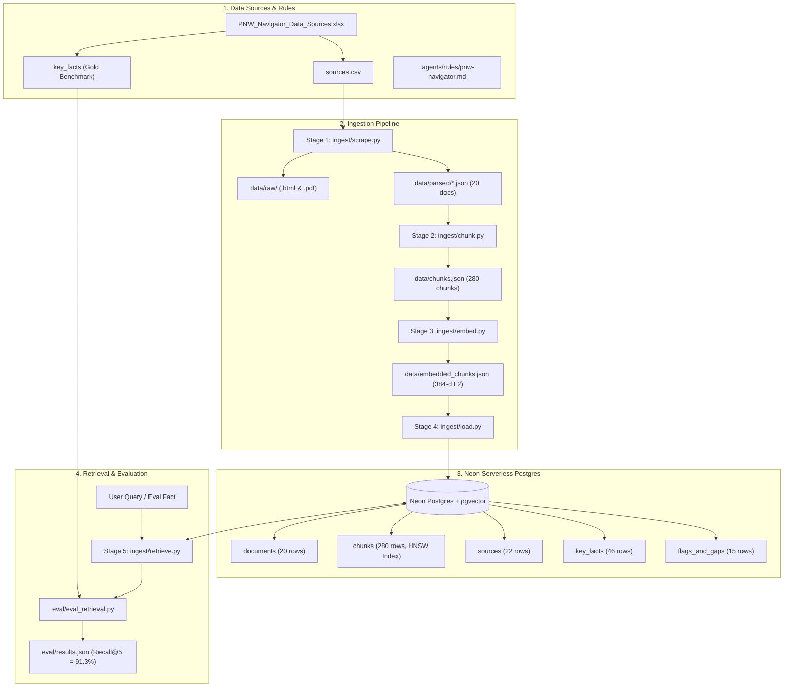

# PNW Navigator — Ingestion & Retrieval Pipeline Walkthrough

This document provides a comprehensive technical overview and walkthrough of everything built, configured, and evaluated for the **PNW Navigator** ingestion and vector retrieval pipeline.

---

## 1. High-Level Architecture

The goal of this project is to build an accurate, citation-backed RAG (Retrieval-Augmented Generation) assistant for international students at **Purdue University Northwest (PNW)**. The pipeline runs from raw data discovery to vector retrieval evaluated against a verified ground-truth benchmark.



---

## 2. Infrastructure & Database Setup

- **Database Provider**: Neon Serverless Postgres (PostgreSQL 18.6).
- **Vector Engine**: Enabled the `pgvector` extension (v0.8.6).
- **Index**: Built an **HNSW** (Hierarchical Navigable Small World) index for fast cosine similarity:
  ```sql
  CREATE INDEX idx_chunks_embedding ON chunks 
  USING hnsw (embedding vector_cosine_ops);
  ```
- **Schema (`ingest/create_schema.py`)**:
  - `sources`: Source metadata register (owner, area, refresh schedule).
  - `key_facts`: Ground truth facts extracted from source pages (46 records).
  - `flags_and_gaps`: Known issues, dead links, and missing documentation (15 records).
  - `documents`: Full page and PDF text and metadata (20 records).
  - `chunks`: Vector-embedded chunks with parent foreign key and metadata JSONB (280 records, `VECTOR(384)`).

---

## 3. Step-by-Step Pipeline Walkthrough

### Stage 0: Rules & Configuration
- **Files**: `.agents/rules/pnw-navigator.md` & `sources.csv`.
- **Safety Constraints**:
  - **Domain Allow-List strictly enforced**: `*.pnw.edu` and `*.pnw.myahpcare.com`. All others rejected.
  - **Secret Safety**: `DATABASE_URL` never printed, logged, or hardcoded.
  - **Ethical Crawling**: Crawl delay $\ge 1.0\text{s}$, custom user agent `PNWNavigatorBot/1.0`.

### Stage 1: Polite Scraper (`ingest/scrape.py`)
- Crawled all entries from `sources.csv`.
- Handled both HTML (via `BeautifulSoup4`) and PDF documents (via `pypdf`).
- Cleanly handled edge cases:
  - `ISS-03`: Safely caught and logged HTTP 404 (known dead link per flags register).
  - `REG-03`: Placeholder URL blocked safely by domain filter.
- **Output**:
  - `data/raw/`: 20 raw `.html` and `.pdf` files.
  - `data/parsed/`: 20 structured JSON files containing **129,311 characters** across **118 extracted sections**.

### Stage 2: Heading-Aware Chunker (`ingest/chunk.py`)
- Designed specifically to adhere to the `all-MiniLM-L6-v2` token limit (256 tokens):
  - **Structure-Aware**: Splits text by headings (`h1`–`h4`) and paragraph blocks rather than arbitrary character splits.
  - **Context-Injecting**: Prepends `[<Heading>]` to every chunk so standalone chunks retain semantic context (e.g., bullet points or deadlines).
  - **Parameters**: Max characters = 700, overlap = 80 characters.
- **Output (`data/chunks.json`)**:
  - Total Chunks: **280**
  - Character Metrics: Min = 15, Max = 868, Avg = **501.4 characters**
  - Token Estimate: Peak chunk was **217 tokens** (well within the 256-token model ceiling).

### Stage 3: Embedding Generator (`ingest/embed.py`)
- Model: `sentence-transformers/all-MiniLM-L6-v2` (384 dimensions).
- Enforces strict **L2 Unit Normalization** ($\|v\|_2 = 1.0$) so that inner product equals cosine similarity.
- **Output (`data/embedded_chunks.json`)**:
  - **280 embedded chunks** generated at a throughput of **67.4 chunks/sec**.
  - All 280 vectors verified: $100\%$ unit norm ($\text{norm} = 1.0000$).

### Stage 4: Neon Database Loader (`ingest/db.py` & `ingest/load.py`)
- **Safety Mechanisms**:
  - Built-in `--dry-run` flag that tests transaction preparation and triggers a rollback.
  - Exponential backoff retry mechanism for Neon compute wake-up events.
  - Casts vector embeddings via `%s::vector`.
- **Execution**:
  - Dry run verified 0 mutations.
  - Live load committed **20 documents** and **280 chunks** into Neon Postgres.

### Stage 5: Retrieval & Benchmark Evaluation (`ingest/retrieve.py` & `eval/eval_retrieval.py`)
- **Retrieval Engine**:
  - Queries embedded with unit normalization and matched via pgvector's `<=>` cosine distance operator:
    $$\text{Similarity} = 1 - (\text{embedding} \Leftrightarrow \text{query\_vector})$$
  - Supports `--top-k` and `--area` category filtering.
- **Quantitative Benchmark**:
  - Evaluated against all **46 verified ground-truth facts** in the `key_facts` table.
  - **Results**:
    - **Recall@1**: **87.0%** (40 / 46)
    - **Recall@3**: **91.3%** (42 / 46)
    - **Recall@5**: **91.3%** (42 / 46)
  - Detailed evaluation log exported to `eval/results.json`.

---

## 4. Repository Structure

```
code/
├── .agents/
│   └── rules/
│       └── pnw-navigator.md       # Core scraping, chunking & security guidelines
├── data/
│   ├── raw/                       # 20 raw HTML and PDF files
│   ├── parsed/                    # 20 parsed JSON documents
│   ├── chunks.json                # 280 text chunks with metadata
│   └── embedded_chunks.json       # 280 chunks with 384-d normalized vectors
├── eval/
│   ├── eval_retrieval.py          # Benchmark evaluation script (Recall@k)
│   └── results.json               # Detailed evaluation outputs
├── ingest/
│   ├── check_db.py                # Database health & table count verification
│   ├── create_schema.py           # SQL DDL definitions for Neon Postgres
│   ├── enable_vector.py           # pgvector extension activation
│   ├── ingest_excel.py            # Initial Excel metadata loader
│   ├── scrape.py                  # Polite web & PDF scraper
│   ├── chunk.py                   # Heading-aware document chunker
│   ├── embed.py                   # MiniLM-L6-v2 embedding pipeline
│   ├── db.py                      # Resilient Postgres connection helper
│   ├── load.py                    # Database loader with dry-run support
│   └── retrieve.py                # Semantic similarity search tool
├── sources.csv                    # Parsed list of all 22 official data sources
├── PNW_Navigator_Data_Sources.xlsx # Original seed data source workbook
└── PIPELINE_WALKTHROUGH.md        # This walkthrough document
```

---

## 5. Next Steps

With the retrieval layer operating at **91.3% Recall@5**, the foundation is ready for the synthesis and generation phase:

1. **RAG Answer Synthesizer**: Connect an LLM (via OpenAI, Anthropic, Gemini, or Neon AI Gateway) to generate student-facing answers citing exact `source_id` and URLs.
2. **Hallucination & Policy Guardrails**: Enforce strict refusal rules for missing information, specifically regarding F-1/J-1 visa compliance and deadlines.
3. **API & Interface**: Build a lightweight FastAPI backend or Streamlit chat interface for international student interactions.

